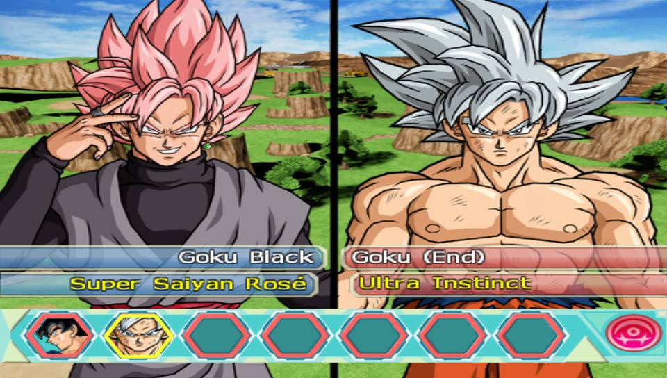
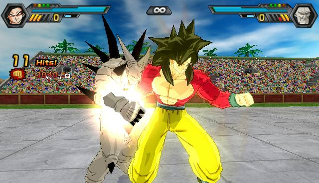
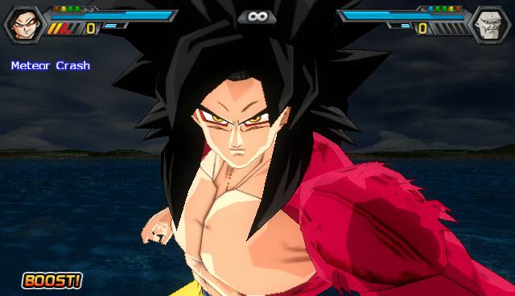
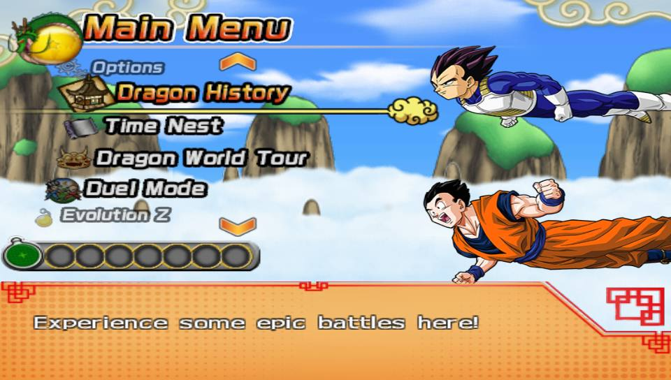
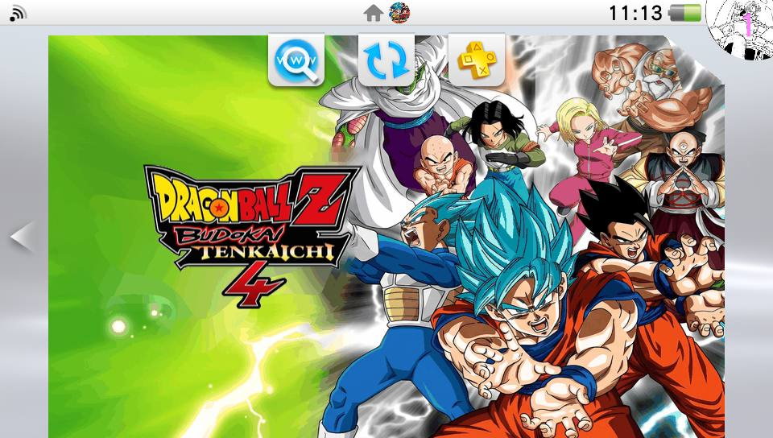
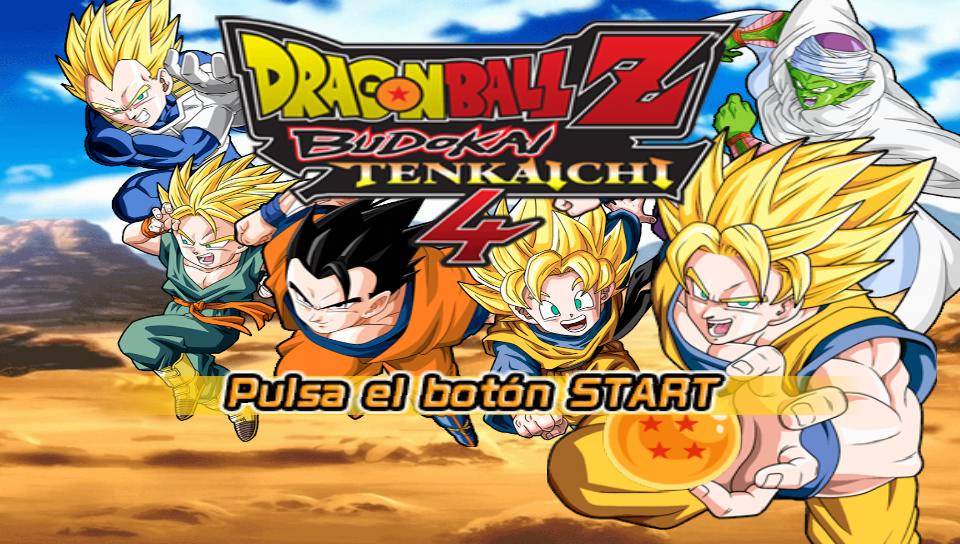
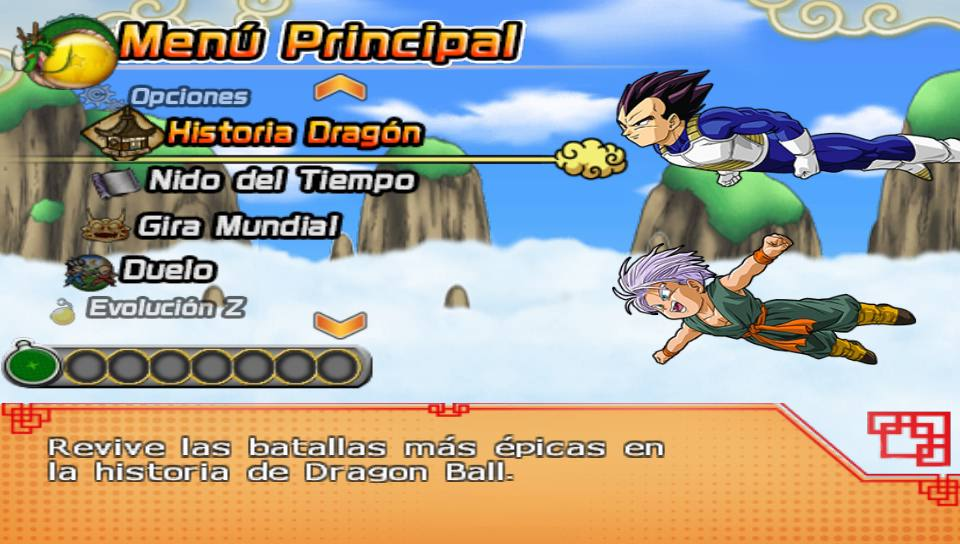
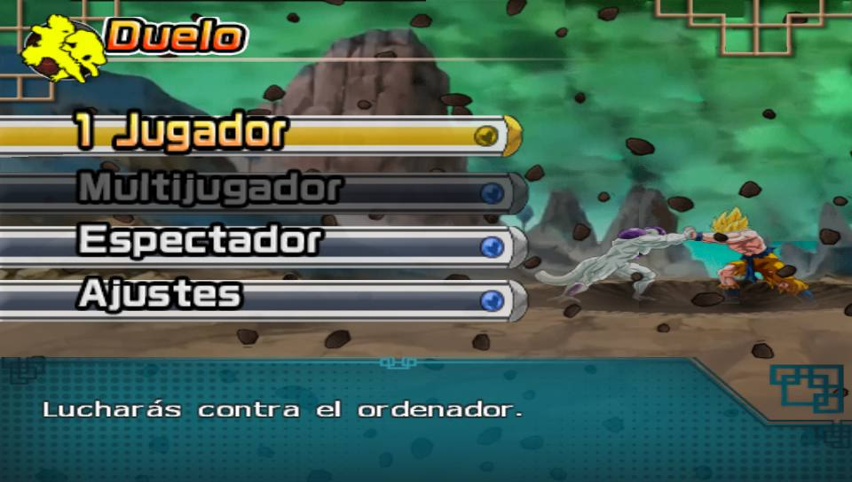
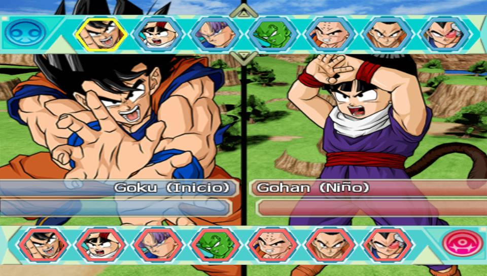

# DBZ-BT4-Tag-Team-Decomp for the PS Vita

A native PS Vita port of **Budokai Tenkaichi 4** (Team BT4's B14 Rev2 of Dragon Ball Z: Budokai Tenkaichi 3),
based on NauTaro's [DBZ-BT4-Tag-Team-Decomp](https://github.com/NauTaro/DBZ-BT4-Tag-Team-Decomp) (BT4decomp, built
on z3xox's [Tenkaichi3Decomp](https://github.com/z3xox/Tenkaichi3Decomp)) and on arielxflores's
[Tenkaichi3Decomp-Vita](https://github.com/arielxflores/Tenkaichi3Decomp-Vita), the BT3 port for the Vita, through
[my fork of it](https://github.com/manumastro/Tenkaichi3Decomp-Vita) (its `optimized` branch: the same speed-ups in
both). The game's own code is compiled for the Vita, with the renderer for the Vita's GPU (vitaGL), the sound, touch
and controls of the BT3 Vita port and all of its speed-ups. It is not an emulator.

This repository contains **no game data**. The game's files are copied from your own disc image of BT4 to the memory
card, see [Game files](#game-files).

This is an unofficial port. It is not affiliated with BT4decomp, Team BT4, Tenkaichi3Decomp or the BT3 Vita port;
please report problems with the Vita version here, not upstream.

<p align="center">
  
  
  
  
</p>

## What BT4 has that the BT3 port does not

This runs BT4's own executable (`SLUS_219.78`), not a mod of BT3's data on the BT3 port, so everything Team BT4 added
to the game is there as its code has it:

- **BT4's roster**: the Dragon Ball Super characters, among them Goku Black (Super Saiyan Rosé), Goku with Ultra
  Instinct, Hit and Cabba, beside the characters of BT3.
- **Outfit Select**: several outfits for a character, shown with their number and name ("1/4", "Battle Damaged"); the
  PC version draws this caption with its own text renderer, which the Vita does not have, so here it is written in
  the game's own letters.
- **BT4's stages**, 35 of them, the Dragon Ball Super ones included. Those are bigger than BT3's: on the BT3 port's
  renderer they overflowed a table and went down to 5-6 fps; here every stage averages 28.8 to 29.5 fps.
- **BT4's menus, title screen and opening film**, and its own music.
- Its own LiveArea, title (BTFV00010) and save folder, so it installs beside the BT3 port.

<p align="center">
  
  
</p>

The Spanish release (Team BT4's Spanish B14 Rev2), read from its `.iso` by the same app:

<p align="center">
  
  
  
  
</p>

## What works

- The game from its opening film through the menus to the fights, saving and loading included: BT4's modes, roster
  and stages, as its own code has them.
- The screen effects: the fighters' outlines, ground shadows, glow, blur and the depth tint.
- Music, voices and sound effects; the opening and ending films.
- Fights are drawn for the Vita's 16:9 screen without stretching; the menus at the screen's full resolution.
- The touch screen works in the menus, and the rear touch pad gives the L2, R2, L3 and R3 buttons the Vita lacks.
- **Tag Team**, offline (new, being tested): the PC version's own Tag Team screens, from the main menu's Tag Team entry (or the Duel
  menu's Tag type). Local Battle: Singleplayer, Two-player, Spectator Mode or Two-player co-op (the two-player modes
  need a second controller), 1 to 5 fighters a team, the time, the CPUs' level, the presets, revival, each fighter's
  health and combat rules, the battle rules; Camera mode: the target selection (L3, right stick or D-pad), the
  special moves' cameras, joint attacks and fusions (its free camera is the PC's only). Then the simultaneous character select, the fight with its Tag Team HUD (names over the
  target, the allies' gauges, the radar) and the results with rematch. 2 vs 2 runs at about 28 pictures a second in the
  console's tests (less in the heaviest specials); 3 vs 3 to 5 vs 5 and Free for All with 10 fighters are there as on
  PC but not measured on the Vita yet. The screens are in English.

Fights run at 30 fps: every one of the 35 stages averages 28.8 to 29.5 pictures a second on a PS Vita 1000 with
CapUnlocker (a survey of a duel on each, 2026-11-13); moments of heavy effects drop below that.

**Not available on the Vita** (the PC version has them):

- Online play, rooms, tournaments, spectators and voice chat.
- Tag Team online (rooms, quick match), and the film behind the Tag Team screens (the Vita shows its still picture).
- The PC version's added songs and stages, its F1 menu (Lua mods, accessibility, HUD editor) and the choice of
  language in the game: the game is in the language of the disc image you copy, English or Spanish.

What changed in each version: [CHANGELOG.md](CHANGELOG.md).

## Installation

Requirements:

- A PS Vita (or PS TV) running HENkaku / Ensō, with VitaShell
- Recommended: the [CapUnlocker](https://github.com/GrapheneCt/CapUnlocker) kernel plugin, which lets the game use
  the Vita's fourth CPU core. Without it the game runs, but heavy scenes are slower.
- About 6 GB free on `ux0:` for the game files (the `.iso` as it is, or the files unpacked from it)
- Your own disc image of Team BT4's Budokai Tenkaichi 4 **B14 Rev2** (see [Game files](#game-files))

Steps, for a first installation:

1. **The disc image.** You need your own image of Team BT4's **B14 Rev2**, English or Spanish (no other build works,
   see [Game files](#game-files)). If it came packed (`.7z`, `.zip`, `.rar`), unpack it **on a computer** with
   [7-Zip](https://www.7-zip.org/): the game reads the `.iso`, not the archive, and phone unpackers often fail on an
   archive this large. Check the size of the `.iso`: 5,914,853,376 bytes for the English release, 5,396,742,144 for
   the Spanish one. A smaller file is a copy cut short; unpack or copy it again.
2. **The memory card.** The `.iso` is one file of about 6 GB. A card formatted as FAT32 (common with SD2Vita) cannot
   hold a file over 4 GB: on such a card copy the files unpacked from the image instead (see
   [Game files](#game-files)), or format the card as exFAT.
3. **Optional, recommended: CapUnlocker.** Install the [CapUnlocker](https://github.com/GrapheneCt/CapUnlocker)
   plugin as its page says and restart the Vita. The game runs without it, but heavy scenes are slower.
4. **The app.** Download `BT4-Vita.vpk` from the
   [releases page](https://github.com/manumastro/DBZ-BT4-Tag-Team-Decomp-Vita/releases) (the `.vpk`, not the source
   code). Copy it to the Vita with VitaShell (USB or FTP), open it in VitaShell and confirm the installation.
5. **The game files.** Copy the `.iso` as it is, under any name ending in `.iso`, to `ux0:data/bt4/` with VitaShell
   (USB or FTP). If the folder is not there, make it in VitaShell, or start the game once: it makes the folder
   itself. An image already in `ux0:data/bt3/bt4/` for the BT3 Vita port is found there too: one copy serves both.
6. **Start Dragon Ball Z: BT4** from the LiveArea. If the files are not found, the screen says where it looked and
   what it found ([Troubleshooting](#troubleshooting)).
7. **Optional: everything unlocked**, see [Unlock All](#unlock-all).

Questions players often ask: [FAQ](#faq).

It installs beside the BT3 port: the two keep their files apart (`ux0:data/bt3/` and `ux0:data/bt4/`). For BT3 with
the same speed-ups as this port, see my BT3 fork's releases:
[Tenkaichi3Decomp-Vita (optimized)](https://github.com/manumastro/Tenkaichi3Decomp-Vita/releases).

## Game files

You need the disc image (`.iso`) of **Budokai Tenkaichi 4 B14 Rev2**, Team BT4's release, in English or in Spanish.
The game finds out which of the two it is (from the size of `SLUS_219.78`) and runs in its language (the Spanish
release, players say, has the anime's soundtrack). The English one, which this port is made and tested with, is

| | |
|---|---|
| File | `SLUS_219.78.DBZBT4B14REV2ENG.iso` |
| Size | 5,914,853,376 bytes |
| MD5 | `27a84d51cbc44252c3aa4e50b604621d` |
| SHA-1 | `7505d8c3494d0889c8d5d3f493c9f920a9f34d64` |

The Spanish release's image (Team BT4's `NTSC SPANISH`) is used the same way. It has been run on a Vita 1000 from
its `.iso`, through the menus to the character select (the screenshots above); fights in it have not been played
through yet, so reports are welcome ([issues](https://github.com/manumastro/DBZ-BT4-Tag-Team-Decomp-Vita/issues)).

| | |
|---|---|
| File | `SLUS_219.78.DBZBT4B14REV2.iso` |
| Size | 5,396,742,144 bytes |
| MD5 | `4c7fb6375b79fe58e254db9891925f2e` |
| SHA-1 | `4f44af3a1cf41625955a4b4140ea6918e454bd1c` |

Other builds of BT4 (Beta X, earlier betas) and the original BT3 disc are not supported. Copy the image
as it is to `ux0:data/bt4/` with VitaShell (USB or FTP), under any name ending in `.iso`:

```
ux0:data/bt4/SLUS_219.78.DBZBT4B14REV2ENG.iso
```

A folder one level down works too, as an archive unpacks it: Team BT4's own archive holds the image in `PS2_NTSC/`, so
unpacking it into `ux0:data/bt4/` as it is (`ux0:data/bt4/PS2_NTSC/SLUS_219.78.DBZBT4B14REV2.iso`) is enough.

The image is also found where the BT3 Vita port keeps it (`ux0:data/bt3/bt4/`, its Spanish one in
`ux0:data/bt3/bt4/es/`), in `ux0:bt4/` and in `ux0:bt3/bt4/`, unpacked or as the `.iso`: one copy serves both apps.
The image is about 6 GB, more than one file can be on a memory card formatted as FAT32 (common with SD2Vita): on
such a card copy the unpacked files instead (each of them is smaller), or format the card as exFAT.

The game reads its files from the image (arielxflores's reader, from his BT3 Vita port's v1.2). Or copy only
`SLUS_219.78` and the `BIN` and `DATA` folders from the image, so that the memory card has:

```
ux0:data/bt4/disc/SLUS_219.78
ux0:data/bt4/disc/BIN/DBZ4.BIN
ux0:data/bt4/disc/BIN/DBZP.BIN
ux0:data/bt4/disc/DATA/PZS4US0.AFS
ux0:data/bt4/disc/DATA/PZS4US1.AFS
ux0:data/bt4/disc/DATA/PZS4US2.AFS
ux0:data/bt4/disc/DATA/PZS4US3.AFS
ux0:data/bt4/disc/DATA/ZS4USOP.PSS        (and the other files of the DATA folder)
```

- **Windows:** open the `.iso` with [7-Zip](https://www.7-zip.org/), select `SLUS_219.78`, `BIN` and `DATA` and
  extract them into a folder named `disc`.
- **Linux / macOS:** `7z x -odisc your-image.iso SLUS_219.78 BIN DATA`

Then copy the `disc` folder to `ux0:data/bt4/` with VitaShell (USB or FTP), or put the memory card in a card reader.
Unpacked files are used first when both are there. BT4's archives have no file table of their own: the game reads it
from `BIN/DBZ4.BIN` (in the image or unpacked), as BT4decomp's installer does.

## Controls

The **Normal** control type of the Vita version:

| Vita | Action |
|---|---|
| Left stick | Move |
| Square | Fight |
| Triangle | Ki Blast |
| Cross | Dash |
| Circle | Guard |
| L | Ki Charge |
| R | Ascend |
| Rear touch pad, upper left quarter (L2) | Blaster Wave |
| Rear touch pad, upper right quarter (R2) | Descend |
| Rear touch pad, lower left / lower right quarter | L3 / R3 |
| START | Pause |

On a PS TV, or with a DualShock paired, the controller's own L2, R2, L3 and R3 buttons are used.

- The rear touch pad's quarters are those of PS4 Remote Play, so the triggers and rear buttons of a grip attachment
  for it work as L2, R2, L3 and R3.
- **Options → Controller → Vita Settings** has these settings (the four plates, and **Stick** below them: press
  Down from the lower row, or Up from the upper one):
  - **Touch**: for each of L2, R2, L3 and R3, where it is touched: its quarter of the rear pad, a corner of the
    front screen (L2 / R2 the bottom corners, L3 / R3 the top ones), or nowhere (Off). SELECT + L / R also give
    L2 / R2.
  - **Clashes**: BT4 counts button presses in a clash: Triangle (Ki Blast) in a beam struggle, Square (Fight) in a
    clash of blows. **Square** (the default): Square counts in both, so pressing Square again and again wins any
    clash (Triangle works as well). **Stick**: turning the left stick round wins them, each quarter turned counting
    as a press. The buttons always work too.
    Below them, **ON / OFF** is the **clash assist** (off by default): with it on, holding Square or Triangle in a
    clash presses it for you about ten times a second.
  - **2nd Pad**: a second controller plays as player 2 (on by default).
  - **Mods**: the files in `ux0:data/bt4/mods/` are used (on by default; see [Mods](#mods)).
    On the English game it has a second row, **ON / OFF**: the **anime soundtrack** (off by default), see
    [the question below](#faq-anime-soundtrack).
  - **Stick**: makes the sticks less quick. Left / Right sets a **dead zone** of 0 (the default: the sticks as they
    are) to 40%, the part of the stick's travel from the centre that does nothing, on top of the game's own; Up /
    Down sets the **response**, even (the default) or soft (half way out gives a quarter, for finer control).
    Cross keeps them, Circle leaves them as they were. Both sticks.
- **Options → Controller → Control Type → Custom** assigns the actions to other buttons, as on the PS2.
- In the menus, tap an item to move to it and tap it again to choose it; swipe to scroll, and tap with two
  fingers to go back. A tap skips a film.
- Holding START + SELECT for two seconds closes the game (press START on the screen that follows).

## Tag Team

**Main menu → Tag Team** (or **Duel → Tag**). These are the PC version's own screens, made larger for the Vita's
screen.

1. **Local Battle**: choose the **Mode** (Singleplayer: you and CPU allies against CPUs), the size of each team (2 vs
   2 plays well; 3 or more a team is still too slow), the time, the CPU level, then **Select Fighters**. Each row's
   description at the bottom says what it does.
2. **Character select**: both teams pick in turns, then the stage and the music.
3. **In the fight**:

| Vita | Action |
|---|---|
| **Right stick** | Choose which enemy you target (a ring and a health bar mark him) |
| Stay near a downed ally | Revive him (more helpers are faster; moving or being hit interrupts) |
| Hold **L2** + press **SELECT** | Eat a Senzu Bean (if the rules give you any) |
| **R3** + direction, near a compatible ally | Cooperative fusion (**L3** + **R3** separates a temporary one) |

Everything else is the game's usual controls. The HUD: your bar top left, your allies down the left side, the enemy
you target with his own bar, and the radar top right.

- **Tag Team → Camera mode → Target selection** changes the target button: **Right stick** (the Vita's default), L3
  (the PC's: on the Vita a rear touch quarter or a screen corner, see [Controls](#controls)) or the D-pad.
- The text and HUD sizes are `tagui_scale=130` and `taghud_scale=135` (percent) in `ux0:data/bt4/bt3.txt`, if you want
  them larger or smaller.

## Unlock All

Three ways to open its screen:

- **in the menus**: hold SELECT for about a second (after your save is loaded, in the main menu for instance);
- **in Vita Settings**: Options > Controller > Vita Settings, then SQUARE;
- **at the start**: press SELECT as the game starts (a short press at any moment before its first picture is enough).

Chosen at the start, or before the title screen is left, it is done as the title screen is left: to the save the game
loaded, or to the one New Game makes.

CROSS gives your save everything: every character and form, stage, song and item, the dragon flags, every Dragon
History saga, and at least 4,850,000 Zenni. It is the game's own unlock routine (the developers left it in, never
called; arielxflores's Vita port offers it the same way), without what that routine erased (the Data Center's saved
characters, and money above 4,850,000). The fighters BT4 numbers after BT3's have no unlock bit in the save and are
not locked by it; if a fighter still shows locked after Unlock All, the log names it (send it with your report).

It is written to your save file at once (`ux0:data/bt4/saves/card1/BASLUS-21678DBZT3/BASLUS-21678DBZT3`), which is
copied beside it first: to `.bak` the first time (never written over), to `.last.bak` the times after. The screen says
whether the file was written; when it was not (no save file yet, or a new game you chose not to save), the game keeps
the unlock when it saves next. Your save as it was before the first unlock is also copied to
`ux0:data/bt4/saves/unlock_undo.bin`, and the same screen then offers to undo it (TRIANGLE), which puts that copy back
(what was played since then is lost). The copy v1.2 to v1.3 made, `unlock_backup.bin`, is left as it is. What was done
is in `ux0:data/bt4/log.txt`. The PS2's cheat codes (PCSX2 pnach, CodeBreaker) do nothing here: this is not an
emulator.

## Mods

Files in `ux0:data/bt4/mods/` are used instead of the disc's, laid out as for the BT3 Vita port, with BT4's archive
names:

```
ux0:data/bt4/mods/pzs4us1/00042.bin      file 42 of DATA/PZS4US1.AFS (pzs4us0, pzs4us2, pzs4us3 for the others)
ux0:data/bt4/mods/disc/DATA/<NAME>       a file of the disc's DATA folder
ux0:data/bt4/mods/<Pack>/pzs4us1/00042.bin   the same inside a pack of its own (packs in the order of their names;
                                             one whose name starts with _ is skipped)
```

Mods that change only data files work. **Vita Settings → Mods** shows what is in use and turns it all off without
deleting anything (from the next start). The PC version's Lua mods (Modern HUD, Modern Camera and the others) are
not available.

## Troubleshooting

- **"The game's files were not found"**: the disc image (`.iso`) of Team BT4's B14 Rev2 must be in `ux0:data/bt4/`
  (or its `disc` or `disk` folder), or `SLUS_219.78` and the `BIN` and `DATA` folders in `ux0:data/bt4/disc/`. The
  message lists what it found instead. An image of another build, or one that is not a plain ISO 9660 copy of the
  disc, is not used; earlier versions said "An .iso can't be read as it is": update the game, or extract the three
  items with 7-Zip.
- **"BT4's archive index was not found"**: `BIN/DBZ4.BIN` is missing from the unpacked files in `ux0:data/bt4/disc/`
  (copy the whole `BIN` folder), or the image is not B14 Rev2's.
- **The picture is smaller, with black borders, in fights only** (the menus fill the screen): the fights are drawn
  at 640 x 368 and the system stretches them to the screen; the Sharpscale plugin in its Integer or Real scaling
  mode shows them at their own size instead. Set Sharpscale's scaling mode back to Original. Do not use
  `fightres=960` for it: the fights drawn at the screen's own size ran at 18.9 pictures a second in a 2 vs 2 fight
  (29.3 at the default size), too slow to play. When reporting it, attach `ux0:data/bt4/log.txt`: its lines starting with `display:` and `vgl: the picture is drawn
  at` say what size was drawn and what the system was given.
- **"The .iso is cut short"**: the copy on the memory card is smaller than the disc (the screen gives both sizes). The
  copy stopped early, or the card is FAT32, which holds files up to 4 GB: copy the image again, to an exFAT card, or
  copy the unpacked files instead ([Game files](#game-files)).
- **A `.7z` (or `.zip`, `.rar`) in the folder does nothing**: the game reads only the `.iso` or the unpacked files.
  Unpack the archive on a computer with 7-Zip (phone unpackers often fail on one this large) and check the `.iso`'s
  size against [Game files](#game-files).
- **An older build (B13, Beta X, earlier betas)**: not supported, only B14 Rev2 (English or Spanish). The game does
  not check which build an image is: with another one it may not start, or may stop later. Use a B14 Rev2 image.
- **The game stops** (the picture freezes, the music plays on): the game writes `ux0:data/bt4/hang.txt` when its
  picture stops for a few seconds. Attaching it and `log.txt` to a bug report helps a lot.
- **Reporting a crash or a bug**: open an [issue](https://github.com/manumastro/DBZ-BT4-Tag-Team-Decomp-Vita/issues)
  and attach `ux0:data/bt4/log.txt` (and `log-prev.txt` if the problem was a few starts ago), plus `hang.txt` if it is
  there. Say what you were doing (mode, characters, stage, the move), the console (PS Vita 1000, 2000 or PS TV), the
  version of the game and the plugins you use (the log lists the ones in `config.txt`). The log is in
  `ux0:data/bt4/` even when the game files are elsewhere.

## FAQ

**This port or arielxflores's?** arielxflores's [BT3 Vita port](https://github.com/arielxflores/Tenkaichi3Decomp-Vita)
also runs BT4 B14 Rev2 (experimental there), inside its BT3 app. This one is BT4 only, on the same code with its
speed-ups. The two can be installed side by side: they are different apps with different titles.

| | This port | arielxflores's BT3 Vita port |
|---|---|---|
| The app | BT4 only, its own app: "Dragon Ball Z: BT4", title BTFV00010 | BT3, with BT4 chosen inside it (title BTTD00010) |
| Game files and saves | `ux0:data/bt4/` (the image is also found in `ux0:data/bt3/bt4/`) | `ux0:data/bt3/bt4/` |
| Speed-ups | The BT3 fork's renderer work and arielxflores's 1.2 speed-ups, all but his dynamic fight resolution; every stage 28.8 to 29.5 fps on a PS Vita 1000 with CapUnlocker | See its page |
| Unlock All | Yes, SELECT at the start or held in the menus ([Unlock All](#unlock-all)) | Yes, see its page |
| Tag Team offline (you and CPUs, 2 vs 2) | From v1.4 | See its page |
| Online play | No | See its page |

**Should I install this instead of BT3?** No need to choose: BT3 and BT4 are different games, and this app does not
replace the BT3 port. Both stay installed, each with its own files and saves (`ux0:data/bt3/` and `ux0:data/bt4/`).

**How do I get the game in Spanish?** Use Team BT4's Spanish B14 Rev2 image instead of the English one. The port runs
the game in the language of the image it finds, with that release's texts and music; there is no language choice in
the game. On the Spanish image Options > Controller > Vita Settings has its lettering too (drawn over that disc's own
pictures); the Duel menu's "Multiplayer" row keeps that disc's own name, in the same place.

<a id="faq-anime-soundtrack"></a>
**Can I play in English with the anime soundtrack of the Spanish release?** Yes, as on the PC version. Copy your own
Spanish B14 Rev2 image to `ux0:data/bt4/es/` (any name ending in `.iso`; the English image stays where it is, for
example in `ux0:data/bt4/`), then turn on **Options -> Controller -> Vita Settings -> Mods**, lower row, **ON**. The
game stays English (texts, voices); its songs come from the Spanish image, from the next song on. Elsewhere on the
card, name the Spanish image in `ux0:data/bt4/bt3.txt` with a line `es_disc=ux0:path/to/the.iso`. Without it the
English songs play as before.

**Is there a full save?** Use [Unlock All](#unlock-all): every character and form, stage, song and item, and
4,850,000 Zenni, with a copy of your save kept first.

**Daima characters or missions?** The characters, stages and missions are those of Team BT4's B14 Rev2: the port
runs that build's own code and data and adds none. Other builds are not supported.

**Online play, or matchmaking with the PC version?** Not on the Vita. The PC version's online code is left out of
the Vita build; what porting it would take is studied in [docs/vita/online-bt4.md](docs/vita/online-bt4.md), with
nothing built yet and no date.

**It crashes, or the picture is wrong**: see [Troubleshooting](#troubleshooting), and attach `log.txt` (and
`hang.txt`) from `ux0:data/bt4/` to the report.

## Notes

- Saves (a virtual memory card) and settings are kept in `ux0:data/bt4/`: `saves/`, `bt3_settings.txt` (Clashes
  and the assist, 2nd Pad, Mods, Stick) and `touch.txt` (Touch). `log.txt` there describes the last runs (`log-prev.txt` the ones before).
- The game's shaders come already compiled in the package (`shbank.bin`): `libshacccg.suprx` is not needed.
- The port runs the Vita at its standard maximum clocks (CPU 444 MHz, GPU 222 MHz); no overclocking plugin is
  used or needed.
- Optional settings go in `ux0:data/bt4/bt3.txt`, one per line: `wide=0` shows the PS2's original 4:3 picture,
  `disc=<folder>` reads the game files from another folder, `fightres=720` or `960` draws the fights at 720 x 408
  or 960 x 544 instead of 640 x 368 (sharper but slower: 960 measured 18.9 pictures a second in a 2 vs 2 fight against
  29.3, not playable; 720 not measured).

## Building

As the BT3 Vita port: [docs/vita/building.md](docs/vita/building.md) (VitaSDK, vitaGL with this port's changes in
`port/vita/vitagl`, Python 3 and libclang; no game files are needed to build). On a computer without Linux,
`port/vita/tools/docker_build.sh` builds in Docker. The build makes BT4 (`-DPORT_VITA_BT4`): the release
`BT4-Vita.vpk` (title BTFV00010), and with `BT3_VITA_DEV=1` the development build `BT4-Vita-dev.vpk` (BTFV00008, "BT4
(development)", every test setting of [docs/vita/development.md](docs/vita/development.md), its log
`ux0:data/bt4/log-vgl.txt`).

The tree is BT4decomp's, with the BT3 Vita port merged in (`port/vita/` and its changes to the shared code, most of
them inside `#ifdef PORT_VITA`); `port/vita/vita_bt4.c` turns off what the Vita has no use for (the network, the PC's
windows and menus). BT4decomp's own README is [docs/port/README-BT4decomp.md](docs/port/README-BT4decomp.md); for the
PC version, use [upstream](https://github.com/NauTaro/DBZ-BT4-Tag-Team-Decomp).

## Credits

- [NauTaro](https://github.com/NauTaro) for BT4decomp, and Team BT4 for Budokai Tenkaichi 4
- [z3xox](https://github.com/z3xox) and the contributors of
  [Tenkaichi3Decomp](https://github.com/z3xox/Tenkaichi3Decomp), and the authors of the BT3-Decompiled
  decompilation it uses
- [arielxflores](https://github.com/arielxflores) for [Tenkaichi3Decomp-Vita](https://github.com/arielxflores/Tenkaichi3Decomp-Vita),
  the BT3 port for the Vita this one is built on, and its contributors
- [manumastro/Tenkaichi3Decomp-Vita](https://github.com/manumastro/Tenkaichi3Decomp-Vita), my fork of it, where this port's
  renderer work is made first and from which it is merged here
- Spike, the developer of Dragon Ball Z: Budokai Tenkaichi 3
- [Rinnegatamante](https://github.com/Rinnegatamante) for vitaGL and vitaShaRK, and [bythos14](https://github.com/bythos14)
  for SceShaccCgExt
- [GrapheneCt](https://github.com/GrapheneCt) for CapUnlocker
- The [VitaSDK](https://vitasdk.org/) team
- The third-party code and data used by the port are listed in [THIRD_PARTY.md](THIRD_PARTY.md).

## License

The port's code is under the [GNU Affero General Public License, version 3](LICENSE), as BT4decomp's and
Tenkaichi3Decomp's port code; the earlier port code that came under the MIT license keeps its notice in
[LICENSE-MIT](LICENSE-MIT). `port/vita/vitagl/vitagl.patch` modifies vitaGL and is under vitaGL's license (LGPL-3.0).

The game's code in `src/` and `include/` comes from the decompilation: it belongs to the game's rights holders. This
project is not affiliated with or endorsed by them, and distributes none of the game's data. The LiveArea images and the screenshots (taken on a PS Vita 1000 with the release build) show the game itself and belong to its rights holders. You need your own legally
obtained copy of the game to use it.
