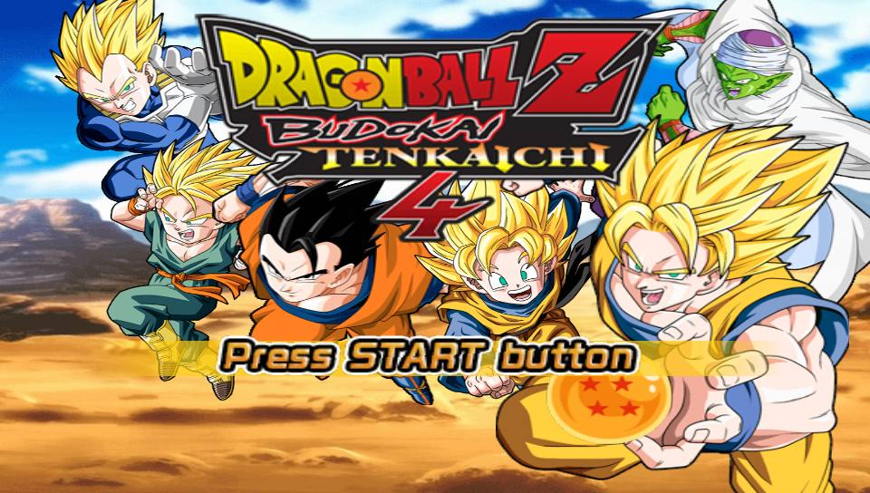
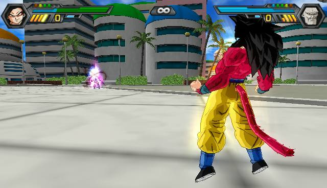

# DBZ-BT4-Tag-Team-Decomp for the PS Vita

A native PS Vita port of **Budokai Tenkaichi 4** (Team BT4's B14 Rev2 of Dragon Ball Z: Budokai Tenkaichi 3),
based on NauTaro's [DBZ-BT4-Tag-Team-Decomp](https://github.com/NauTaro/DBZ-BT4-Tag-Team-Decomp) (BT4decomp, built
on z3xox's [Tenkaichi3Decomp](https://github.com/z3xox/Tenkaichi3Decomp)) and on arielxflores's
[Tenkaichi3Decomp-Vita](https://github.com/arielxflores/Tenkaichi3Decomp-Vita), the BT3 port for the Vita. The game's
own code is compiled for the Vita, with the renderer for the Vita's GPU (vitaGL), the sound, touch and controls of
the BT3 Vita port and all of its speed-ups. It is not an emulator.

This repository contains **no game data**. The game's files are copied from your own disc image of BT4 to the memory
card, see [Game files](#game-files).

This is an unofficial port. It is not affiliated with BT4decomp, Team BT4, Tenkaichi3Decomp or the BT3 Vita port;
please report problems with the Vita version here, not upstream.

## What works

- The game from its opening film through the menus to the fights, saving and loading included: BT4's modes, roster
  and stages, as its own code has them.
- The screen effects: the fighters' outlines, ground shadows, glow, blur and the depth tint.
- Music, voices and sound effects; the opening and ending films.
- Fights are drawn for the Vita's 16:9 screen without stretching; the menus at the screen's full resolution.
- The touch screen works in the menus, and the rear touch pad gives the L2, R2, L3 and R3 buttons the Vita lacks.

Fights run at 30 fps: every one of the 35 stages averages 28.8 to 29.5 pictures a second on a PS Vita 1000 with
CapUnlocker (a survey of a duel on each, 2026-11-13); moments of heavy effects drop below that.

**Not available on the Vita** (the PC version has them):

- Online play, rooms, tournaments, spectators and voice chat.
- Tag Team (the simultaneous team battles): it goes through the PC version's network code, which is not in this port
  yet.
- The PC version's added songs and stages, its F1 menu (Lua mods, accessibility, HUD editor) and the choice of
  language: the game is in English.

What changed in each version: [CHANGELOG.md](CHANGELOG.md).

## Screenshots

Taken on a PS Vita 1000 with the release build.

| | |
|---|---|
|  |  |
|  |  |
|  | |

## Installation

Requirements:

- A PS Vita running HENkaku / Ensō
- `libshacccg.suprx` extracted to `ur0:data/` (see
  [this guide](https://samilops2.gitbook.io/vita-troubleshooting-guide/shader-compiler/extract-libshacccg.suprx))
- Recommended: the [CapUnlocker](https://github.com/GrapheneCt/CapUnlocker) kernel plugin, which lets the game use
  the Vita's fourth CPU core. Without it the game runs, but heavy scenes are slower.
- About 5.5 GB free on `ux0:` for the game files

Steps:

1. Install `BT4-Vita.vpk` from the [releases page](https://github.com/manumastro/DBZ-BT4-Tag-Team-Decomp-Vita/releases)
   with VitaShell.
2. Copy the game files to `ux0:data/bt4/disc/` as described below.
3. Start **Dragon Ball Z: BT4** from the LiveArea.

It installs beside the BT3 port: the two keep their files apart (`ux0:data/bt3/` and `ux0:data/bt4/`).

## Game files

You need the disc image (`.iso`) of **Budokai Tenkaichi 4 B14 Rev2**, Team BT4's release, in English: the one this
port is made and tested with is

| | |
|---|---|
| File | `SLUS_219.78.DBZBT4B14REV2ENG.iso` |
| Size | 5,914,853,376 bytes |
| MD5 | `27a84d51cbc44252c3aa4e50b604621d` |
| SHA-1 | `7505d8c3494d0889c8d5d3f493c9f920a9f34d64` |

Other builds of BT4 (earlier betas, the Spanish version) and the original BT3 disc are not supported. From the image,
copy `SLUS_219.78` and the `BIN` and `DATA` folders, so that the memory card has:

```
ux0:data/bt4/disc/SLUS_219.78
ux0:data/bt4/disc/BIN/DBZ4.BIN
ux0:data/bt4/disc/BIN/DBZP.BIN
ux0:data/bt4/disc/DATA/PZS4US0.AFS
ux0:data/bt4/disc/DATA/PZS4US1.AFS
ux0:data/bt4/disc/DATA/PZS4US2.AFS
ux0:data/bt4/disc/DATA/PZS4US3.AFS
ux0:data/bt4/disc/DATA/ZS4USOP.PSS        (and the other files of the DATA folder)
```

- **Windows:** open the `.iso` with [7-Zip](https://www.7-zip.org/), select `SLUS_219.78`, `BIN` and `DATA` and
  extract them into a folder named `disc`.
- **Linux / macOS:** `7z x -odisc your-image.iso SLUS_219.78 BIN DATA`

Then copy the `disc` folder to `ux0:data/bt4/` with VitaShell (USB or FTP), or put the memory card in a card reader.
BT4's archives have no file table of their own: the game reads it from `BIN/DBZ4.BIN`, as BT4decomp's installer does.

## Controls

The **Normal** control type of the Vita version:

| Vita | Action |
|---|---|
| Left stick | Move |
| Square | Fight |
| Triangle | Ki Blast |
| Cross | Dash |
| Circle | Guard |
| L | Ki Charge |
| R | Ascend |
| Rear touch pad, upper left quarter (L2) | Blaster Wave |
| Rear touch pad, upper right quarter (R2) | Descend |
| Rear touch pad, lower left / lower right quarter | L3 / R3 |
| START | Pause |

On a PS TV, or with a DualShock paired, the controller's own L2, R2, L3 and R3 buttons are used.

- The rear touch pad's quarters are those of PS4 Remote Play, so the triggers and rear buttons of a grip attachment
  for it work as L2, R2, L3 and R3.
- **Options → Controller → Vita Settings** has four settings:
  - **Touch**: for each of L2, R2, L3 and R3, where it is touched: its quarter of the rear pad, a corner of the
    front screen (L2 / R2 the bottom corners, L3 / R3 the top ones), or nowhere (Off). SELECT + L / R also give
    L2 / R2.
  - **Clashes**: **Square** (the default) wins beam struggles and rush clashes by pressing Square again and again,
    instead of turning the left stick; **Stick** turns the stick, as on the PS2.
  - **2nd Pad**: a second controller plays as player 2 (on by default).
  - **Mods**: the files in `ux0:data/bt4/mods/` are used (on by default; see [Mods](#mods)).
- **Options → Controller → Control Type → Custom** assigns the actions to other buttons, as on the PS2.
- In the menus, tap an item to move to it and tap it again to choose it; swipe to scroll, and tap with two
  fingers to go back. A tap skips a film.
- Holding START + SELECT for two seconds closes the game (press START on the screen that follows).

## Mods

Files in `ux0:data/bt4/mods/` are used instead of the disc's, laid out as for the BT3 Vita port, with BT4's archive
names:

```
ux0:data/bt4/mods/pzs4us1/00042.bin      file 42 of DATA/PZS4US1.AFS (pzs4us0, pzs4us2, pzs4us3 for the others)
ux0:data/bt4/mods/disc/DATA/<NAME>       a file of the disc's DATA folder
ux0:data/bt4/mods/<Pack>/pzs4us1/00042.bin   the same inside a pack of its own (packs in the order of their names;
                                             one whose name starts with _ is skipped)
```

Mods that change only data files work. **Vita Settings → Mods** shows what is in use and turns it all off without
deleting anything (from the next start). The PC version's Lua mods (Modern HUD, Modern Camera and the others) are
not available.

## Troubleshooting

- **"The game's files were not found"**: `SLUS_219.78` and the `BIN` and `DATA` folders of Team BT4's B14 Rev2 must be in
  `ux0:data/bt4/disc/`. An `.iso` cannot be read as it is: extract those three items from it with 7-Zip.
- **"BT4's archive index was not found"**: `BIN/DBZ4.BIN` is missing from `ux0:data/bt4/disc/`.
- **The picture fills only part of the screen**: the Sharpscale plugin is set to a resolution other than
  "Original"; set it back to Original.
- **The game stops** (the picture freezes, the music plays on): the game writes `ux0:data/bt4/hang.txt` when its
  picture stops for a few seconds. Attaching it and `log.txt` to a bug report helps a lot.

## Notes

- Saves (a virtual memory card) and settings are kept in `ux0:data/bt4/`: `saves/`, `bt3_settings.txt` (Clashes,
  2nd Pad, Mods) and `touch.txt` (Touch). `log.txt` there describes the last runs (`log-prev.txt` the ones before).
- The first start takes a little longer: the shaders are compiled and kept in `ux0:data/bt4/shcache/`.
- The port runs the Vita at its standard maximum clocks (CPU 444 MHz, GPU 222 MHz); no overclocking plugin is
  used or needed.
- Optional settings go in `ux0:data/bt4/bt3.txt`, one per line: `wide=0` shows the PS2's original 4:3 picture,
  `disc=<folder>` reads the game files from another folder.

## Building

As the BT3 Vita port: [docs/vita/building.md](docs/vita/building.md) (VitaSDK, vitaGL with this port's changes in
`port/vita/vitagl`, Python 3 and libclang; no game files are needed to build). On a computer without Linux,
`port/vita/tools/docker_build.sh` builds in Docker. The build makes BT4 (`-DPORT_VITA_BT4`): the release
`BT4-Vita.vpk` (title BTFV00010), and with `BT3_VITA_DEV=1` the development build `BT4-Vita-dev.vpk` (BTFV00008, "BT4
(development)", every test setting of [docs/vita/development.md](docs/vita/development.md), its log
`ux0:data/bt4/log-vgl.txt`).

The tree is BT4decomp's, with the BT3 Vita port merged in (`port/vita/` and its changes to the shared code, most of
them inside `#ifdef PORT_VITA`); `port/vita/vita_bt4.c` turns off what the Vita has no use for (the network, the PC's
windows and menus). BT4decomp's own README is [docs/port/README-BT4decomp.md](docs/port/README-BT4decomp.md); for the
PC version, use [upstream](https://github.com/NauTaro/DBZ-BT4-Tag-Team-Decomp).

## Credits

- [NauTaro](https://github.com/NauTaro) for BT4decomp, and Team BT4 for Budokai Tenkaichi 4
- [z3xox](https://github.com/z3xox) and the contributors of
  [Tenkaichi3Decomp](https://github.com/z3xox/Tenkaichi3Decomp), and the authors of the BT3-Decompiled
  decompilation it uses
- [arielxflores](https://github.com/arielxflores) for [Tenkaichi3Decomp-Vita](https://github.com/arielxflores/Tenkaichi3Decomp-Vita),
  the BT3 port for the Vita this one is built on, and its contributors
- Spike, the developer of Dragon Ball Z: Budokai Tenkaichi 3
- [Rinnegatamante](https://github.com/Rinnegatamante) for vitaGL and vitaShaRK, and [bythos14](https://github.com/bythos14)
  for SceShaccCgExt
- [GrapheneCt](https://github.com/GrapheneCt) for CapUnlocker
- The [VitaSDK](https://vitasdk.org/) team
- The third-party code and data used by the port are listed in [THIRD_PARTY.md](THIRD_PARTY.md).

## License

The port's code is under the [GNU Affero General Public License, version 3](LICENSE), as BT4decomp's and
Tenkaichi3Decomp's port code; the earlier port code that came under the MIT license keeps its notice in
[LICENSE-MIT](LICENSE-MIT). `port/vita/vitagl/vitagl.patch` modifies vitaGL and is under vitaGL's license (LGPL-3.0).

The game's code in `src/` and `include/` comes from the decompilation: it belongs to the game's rights holders. This
project is not affiliated with or endorsed by them, and distributes none of the game's data. The LiveArea images and the screenshots show the game itself and belong to its rights holders. You need your own legally
obtained copy of the game to use it.
